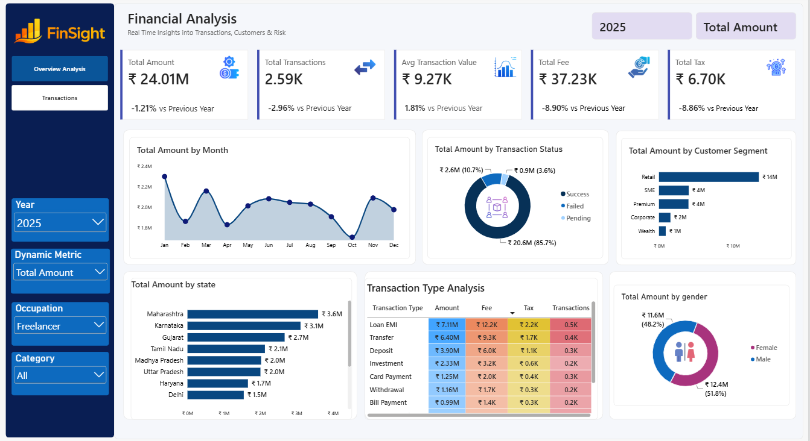
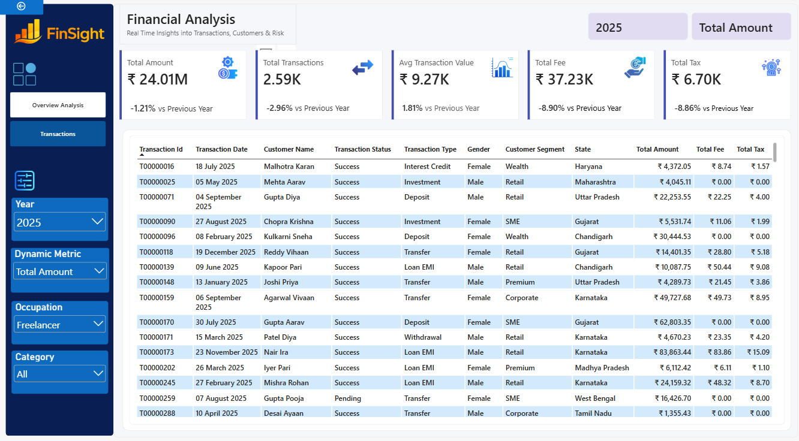

# FinSight – Financial Analysis Dashboard

## Project Overview
FinSight is an interactive financial analysis dashboard developed using Microsoft Power BI to analyze financial transactions, customer behavior, and transaction performance.

## Dashboard Preview

### Overview Analysis

### Transactions

## Key Features
- Total Amount and Total Transactions
- Average Transaction Value, Total Fees and Total Taxes
- Month-wise financial trends
- Transaction status analysis
- Customer segment and gender analysis
- State-wise financial analysis
- Transaction type analysis
- Interactive filters for year, occupation, category and dynamic metric

## Tools and Technologies
- Microsoft Power BI
- Power Query
- DAX
- Data Visualization

## Key Learnings
- Data cleaning and transformation
- KPI cards and financial metrics
- Year-over-year comparisons
- Interactive slicers and report navigation
- Dashboard design and data visualization

## Project Files
- `FinSight-Financial-Analysis.pbix` — Power BI report
- `screenshots/` — Dashboard screenshots

## Author
Akalya R.
